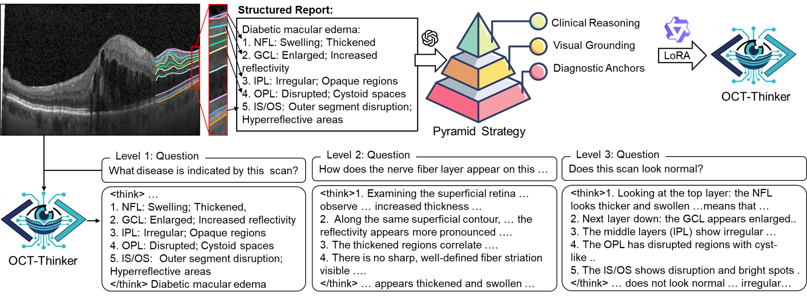
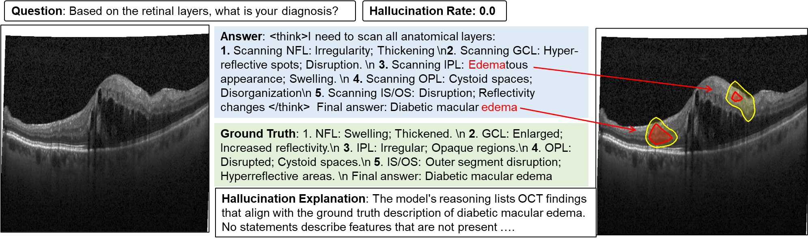

# 👁️ OCT-Thinker: Eliciting Layer-wise Chain-of-Thought in Vision-Language Models for Retinal OCT Understanding

[](#)
[](#)
[](#)
[](#)

> **Note:** This repository is currently anonymized for double-blind peer review. Full code, datasets, and model weights will be publicly released upon acceptance.

## 📖 Introduction

Optical Coherence Tomography (OCT) is a cornerstone imaging modality in ophthalmology. While existing Medical Vision-Language Models (Med-VLMs) have shown promise, they frequently suffer from **severe hallucinations** and adopt a **rigid, single-step "image-to-answer" paradigm** without logical transparency. 

We introduce **OCT-Thinker**, the first reasoning vision-language model tailored for retinal OCT analysis. By emulating the cognitive workflow of medical experts, OCT-Thinker utilizes an explicit `<think>` block to systematically scan and describe anatomical layers (from NFL to IS/OS) before synthesizing a final clinical diagnosis.

### ✨ Key Highlights

- 🧠 **Explicit Chain-of-Thought (CoT) Reasoning**: OCT-Thinker performs a layer-by-layer anatomical scan within a ` <think> ... </think> ` block, providing unprecedented diagnostic transparency and pixel-text alignment.
- 🔺 **The Pyramid Data Construction Strategy**: A novel hierarchical data generation pipeline that seamlessly fuses strictly templated diagnostic anchors, spatially constrained visual grounding, and open-ended clinical inquiries to mitigate medical hallucinations.
- 🏆 **SOTA Zero-Shot Generalization**: Achieves state-of-the-art diagnostic performance (95.21 Macro F1-score) on in-domain data and demonstrates robust cross-domain stability across four external multi-center cohorts (*eye2-zh1fq, oct1, retina-c8, cfkbp*).
- ⚖️ **The Scaling Paradox Insight**: We uncover that naively scaling up model parameters (e.g., from 2B to 8B) without strict visual constraints inherently exacerbates clinical hallucinations due to parametric over-extrapolation. Our strictly grounded 4B model offers the optimal balance between reasoning capacity and diagnostic safety.

---

## 🏗️ Methodology

### The Pyramid Strategy

To balance absolute clinical correctness with conversational flexibility, we construct our instruction-tuning dataset across three hierarchical tiers based on original paired OCT images and layer-wise structured reports:

1. **Level 1: Diagnostic Anchors (Rigorous Zone)** - Ensures absolute clinical correctness and structural causal reasoning.
2. **Level 2: Visual Grounding (Factual Zone)** - Enhances fine-grained pixel-text alignment.
3. **Level 3: Clinical Reasoning (Generalization Zone)** - Translates complex findings into patient-friendly explanations.

<p align="center">
  
</p>

---

## 🩺 Interaction Paradigm

Unlike standard Med-VLMs that jump directly to a conclusion, OCT-Thinker forces a structured reasoning process. Here is a conceptual example of how the model interacts:

**User Prompt:**
> *<image>*
> *Based on this OCT image, what is the most likely diagnosis?*

**OCT-Thinker Response:**
```xml
<think>
I need to scan all anatomical layers:
1. Scanning NFL: Swelling; Thickened.
2. Scanning GCL: Enlarged; Increased reflectivity.
3. Scanning IPL: Irregular; Opaque regions.
4. Scanning OPL: Disrupted; Cystoid spaces.
5. Scanning IS/OS: Outer segment disruption; Hyperreflective areas.
</think>
Final answer: Diabetic Macular Edema (DME).
```

## 📊 Qualitative Interpretability
Our explicit reasoning mechanism not only reduces the clinical hallucination rate to near-zero but also achieves highly accurate visual grounding. The spatial attention weights (visualized below) strictly localize to the hyporeflective, fluid-filled intraretinal cysts when generating the keyword "edema".

<p align="center">

</p>

## 🚀 Release Plan
To foster interpretable AI in ophthalmology and ensure reproducibility, we are committed to open-sourcing our entire pipeline. The following resources will be available in this repository upon publication:

- [ ] 📜 Hierarchical Instruction-Tuning Dataset (OCT-StructQA)

- [ ] 🦙 Pre-trained Model Weights (OCT-Thinker-4B) on HuggingFace

- [ ] 💻 Training and Inference Source Code

- [ ] ⚖️ Evaluation Scripts for LLM-as-a-Judge (Hallucination & CAS)

## ✉️ Contact
For anonymity purposes during the review phase, contact information has been temporarily withheld.
